# Dishlog

A food-memory and discovery app for urban diners in India. This repo holds a clickable, mobile-first prototype.

**Core loop:** Discover → Save → Try → Log → Remember → Recommend

## Run it

It's a single static page with no build step and no dependencies.

- Open `index.html` in a browser, or
- serve the folder (`npx serve .` or `python3 -m http.server`) and open it on your phone.

Data is sample data, stored only in your browser (localStorage). Use **Profile → Reset sample data** to start over.

## What's in it

- **Diary:** photo grid, a timeline with a month calendar, and a map of your food spots
- **Log a dish:** in under a minute, with reaction, note, friends, and visibility per memory (Only me / Friends / Everyone)
- **Revisits:** a repeat visit never overwrites earlier ones
- **Discover:** a feed from friends, Explore, and follow requests
- **Saved:** want to try, then tried, plus collections
- **Game layer:** XP and levels, weekly streaks, badges, food passport, weekly quests, friends league
- **Privacy:** private or public profile, bulk visibility, preview as a friend or a stranger, export, delete

## Screenshots

Taken from the live prototype on a phone-sized screen, using the built-in sample data.

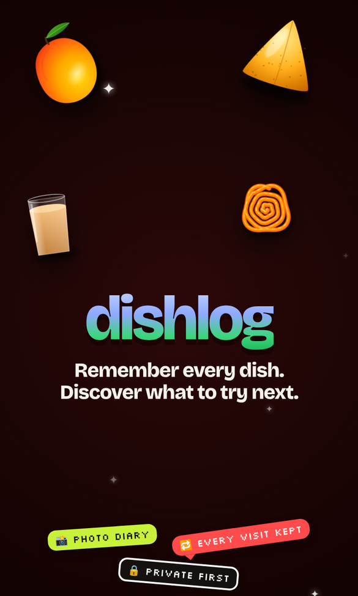

### Diary: photos, timeline and map

Every dish you've logged, as a photo grid, a month calendar, or a map of your food spots. "On this day" brings back an old memory.

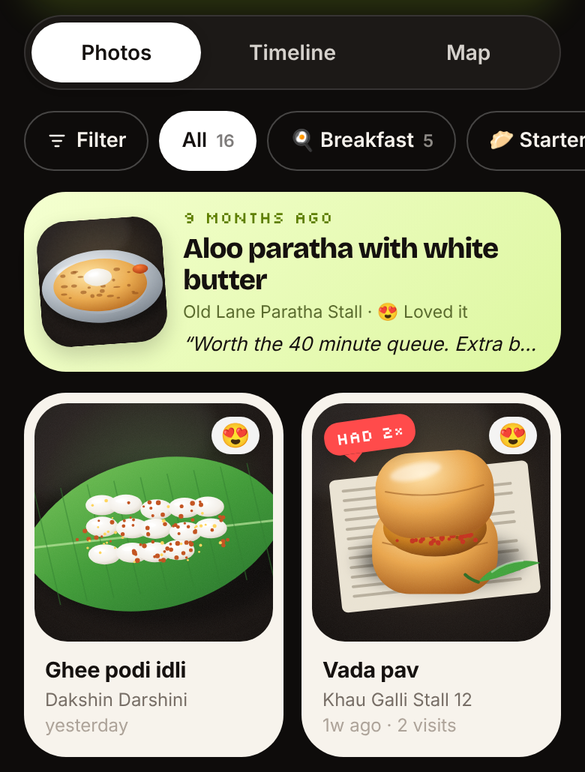
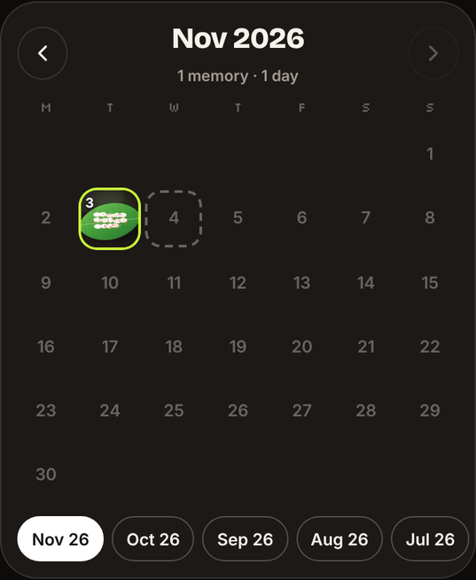
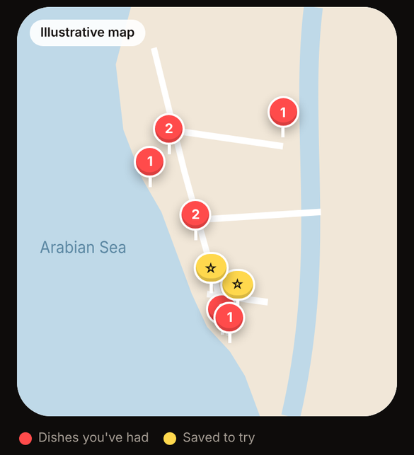

### Log a dish in under a minute

Only three things are required: the dish, the spot and how it was. Three one-tap reactions replace 5-star ratings.

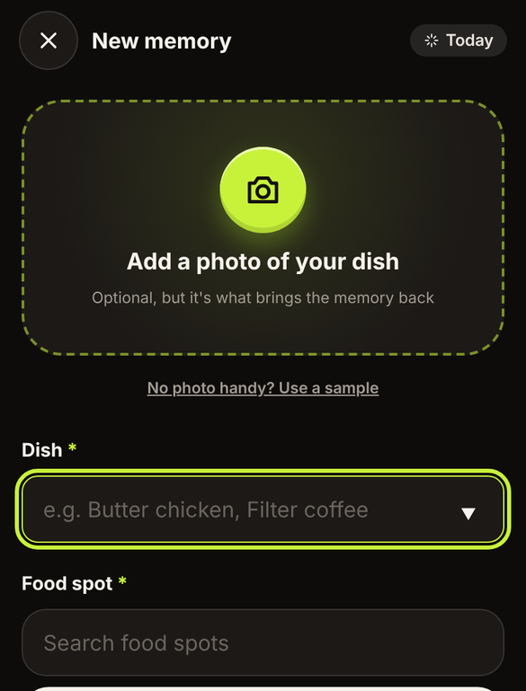
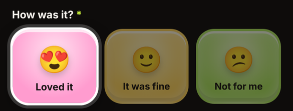

### Revisits never overwrite

"Had it again?" adds a new visit, and every earlier visit is kept in the dish's history.

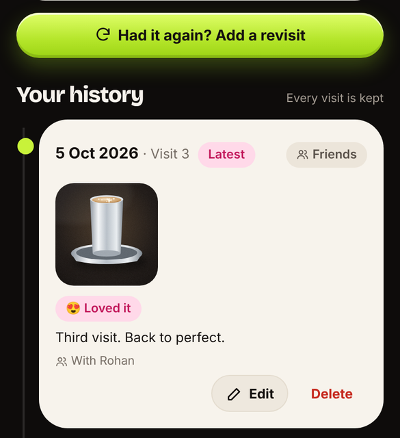

### Privacy per memory

Memories are private by default. You choose who sees each one, set a default, change many at once, and preview your profile as a friend or a stranger.

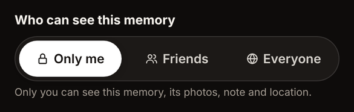
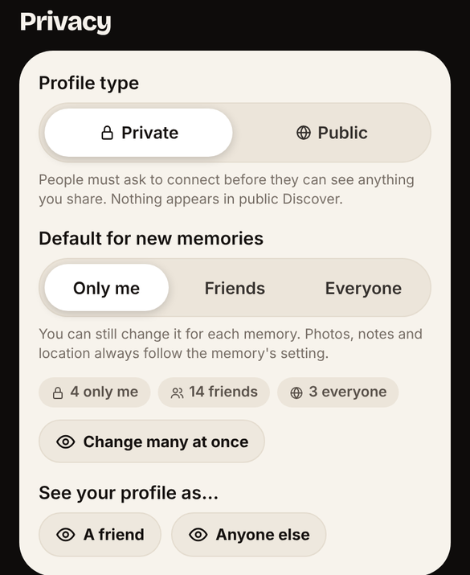

### Discover and Saved: from a friend's tip to a real meal

See what friends shared, save it as "Want to try", then tap "I tried it" to log it.

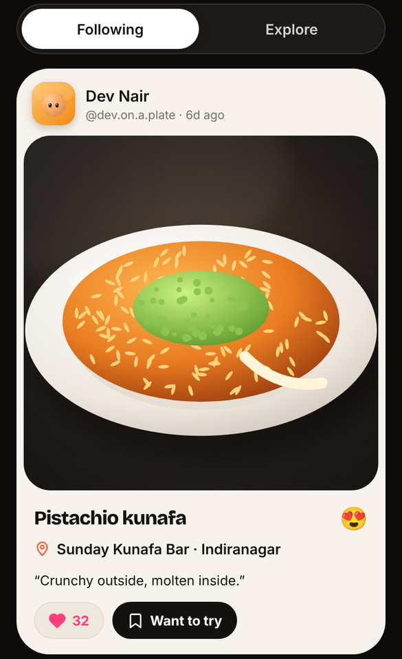
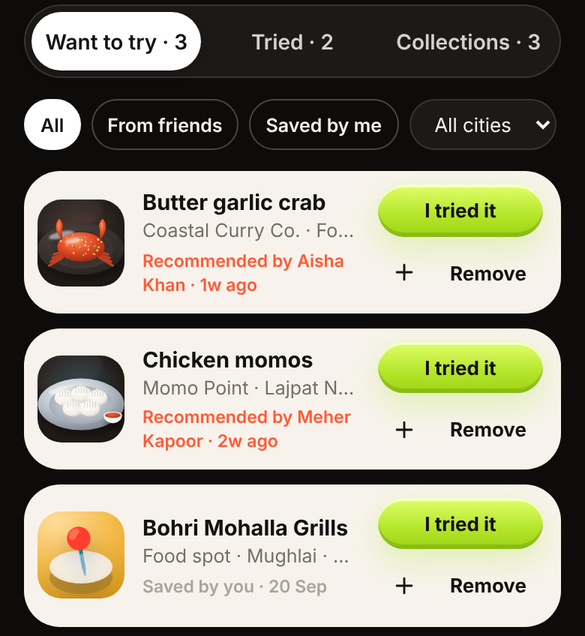

### A quiet game layer

One level card on the Diary, with a weekly (not daily) streak. Badges, quests and the league are one tap away.

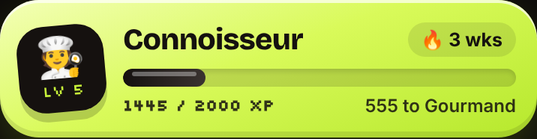

## Files

- `index.html`: the whole app (HTML, CSS, JS)
- `img/mango.svg`, `img/jalebi.svg`: splash illustrations
- `food-art.js`: source for the dish illustrations (already inlined in `index.html`)
- `screenshots/`: images used in this README
